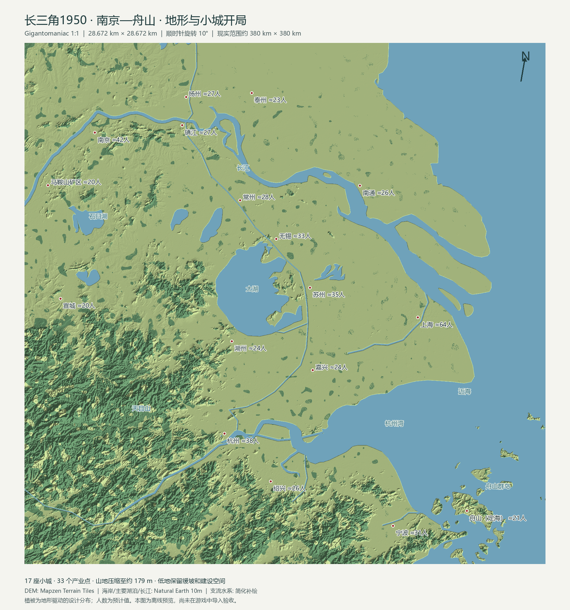

# 长三角 1950 · 南京—舟山

《狂热运输 3》地图导入包，适用于 Windows 版原生地图编辑器。以 1950 年的小城开局，逐步连接长三角的农场、工厂和港口。

**[下载 v0.3.0 地图包](https://github.com/hasbai/TF3_YRD/releases/download/v0.3.0/TF3_YRD_v0.3.0.zip)** · [版本说明与校验文件](https://github.com/hasbai/TF3_YRD/releases/tag/v0.3.0)

## 地图里有什么

- 17 座城市、33 个产业点。每城预计约 19—64 人起步，适合先跑短途货运，再建设干线。
- 覆盖南京、上海、杭州、宁波和舟山，保留舟山主岛、朱家尖及邻近海域。
- 长江、太湖、运河与沿海水域可用于规划水运。舟山（定海）作为海岛城市开局。
- 农业、林业、建材、纺织、煤铁和机械加工链均有布局。

现实范围约 380 × 380 km，压缩到游戏内 28.672 × 28.672 km。地理内容顺时针旋转 10°，南京至舟山沿图中左上至右下展开。

## 怎么开始

1. 下载上方 ZIP 并完整解压。无需安装 Python、地图生成 MOD 或 TPF3 Map Studio。
2. 打开解压目录 `YRD_1950` 中的 `使用说明.md`。
3. 按说明开启实验地图尺寸，在编辑器中依次导入地形、生态蒙版、城市与产业。高度图预览后，仍须点击底部 **Import / 导入**；确认实际地图出现河湖和海面后再继续。
4. 检查城际道路，保存地图，再从该地图开始游戏。

导入时使用以下设置：

| 项目 | 设置 |
| --- | --- |
| 气候 | 温带 / Temperate |
| 地图大小 | Gigantomaniac，需开启实验地图尺寸 |
| 比例 | 1:1 |
| 高度图 | 7169 × 7169，16 位灰度 PNG |
| 最低 / 最高高度 | **−20 m / 240 m** |
| 水位 | **0 m** |
| 开局年份 | **1950** |

这是编辑器导入素材包，需自行导入并保存为地图。包内没有预建车站、铁路、港口和车辆。

原生布局导入会保留城市名称，产业名称由游戏随机生成。v0.3.1（尚未发布）新增导入后恢复产业名称的一次性控制台命令。森林蒙版表示设计的草地树群区域，游戏会生成斑块树群，不代表实测森林覆盖。

## 开局可以做什么

| 玩法 | 线路 |
| --- | --- |
| 短途公路 | 嘉兴农场 → 嘉兴，或南京农场 → 南京，供应蔬菜 |
| 建材加工 | 宜兴黏土矿 → 宜兴砖厂 → 常州、镇江或南京 |
| 水运 | 太湖渔场 → 湖州；舟山近海渔场 → 舟山（定海），供应鱼类 |

小城开局客运量少，可先经营一至两条货运链。产业编号、需求和更多线路见包内 `使用说明.md` 及产业布局预览。

## 地图依据与验证情况

地形基于现代高程和岸线，河道为游戏适度加宽，部分支流为简化补绘。人口、植被和产业按开局玩法设计；本图不是 1950 年测绘或企业分布的复原。

v0.3.0 已通过文件格式、点位、静态供需链及海域连通等离线检查。游戏内导入、船舶寻路和开局经济尚未实测。

## 修改地图与数据来源

[生成和修改地图](docs/development.md) · [来源与制作口径模板](docs/methodology.md)

代码采用 [MIT 许可](LICENSE)。高程来自 Mapzen Terrain Tiles，海岸、主要湖泊和长江数据来自 Natural Earth。数据署名和许可见包内 `docs/来源与制作口径.md`。
